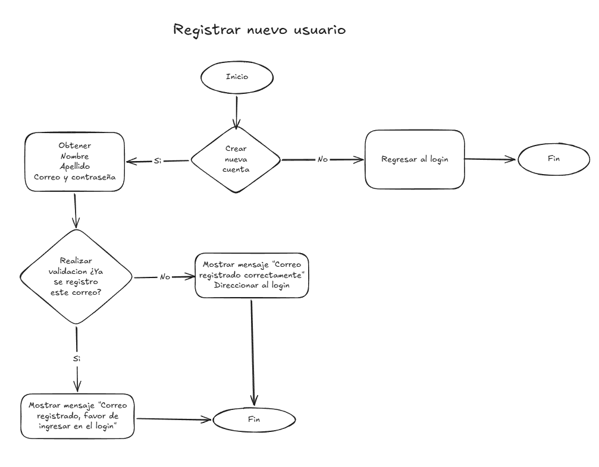
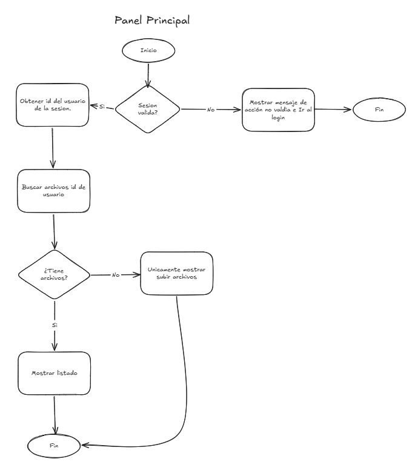
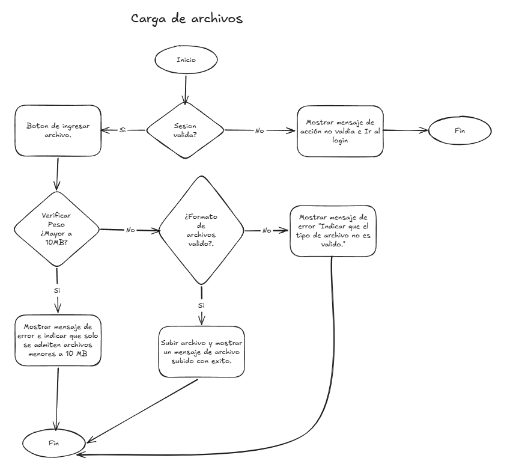
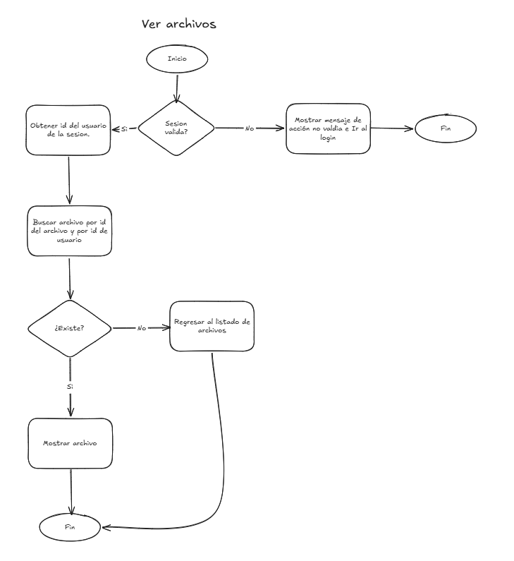
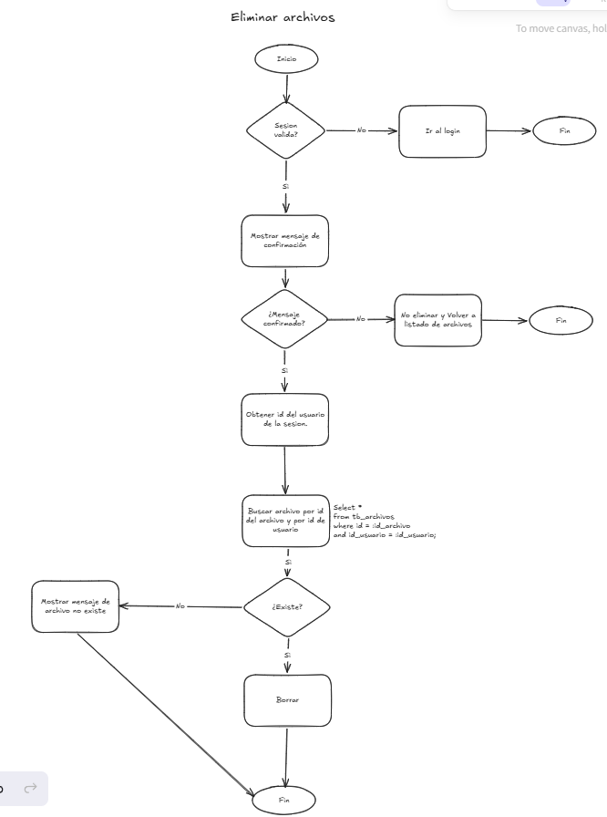
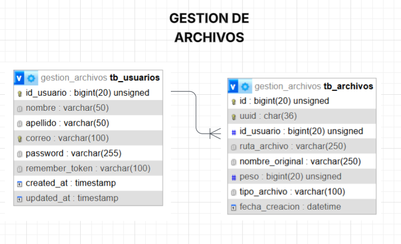

# Análisis y diseño del proyecto: Gestión de Archivos
Este documento describe la etapa de análisis que se realizó antes de comenzar el desarrollo del proyecto y el diseño de la base de datos que se elaboró durante la programación.

## 1. Etapa de análisis
Al iniciar el proyecto, antes de escribir código, se realizó una etapa de análisis. En lugar de comenzar a programar directamente, primero se estudió qué debía hacer el sistema, quiénes lo usarían y en qué orden ocurrían las acciones.

### 1.1 Qué se analizó

- **Actor del sistema:** el usuario, que debe estar registrado y con sesión iniciada para acceder a sus archivos.
- **Funcionalidades requeridas:** registro, inicio de sesión, carga de archivos, listado de archivos propios, descarga o apertura, eliminación y cierre de sesión.
- **Mensajes de error:** qué debe ver el usuario cuando algo falla (archivo demasiado grande, tipo no permitido, credenciales incorrectas, sesión vencida).

### 1.2 Diagramas de flujo

Como resultado del análisis se elaboraron **diagramas de flujo**, que permiten ver paso a paso cómo funcionará la aplicación web: qué ocurre cuando el usuario realiza cada acción, qué decisiones toma el sistema

### 1.3 ¿Por qué se hicieron antes de programar?

Los diagramas de flujo ayudaron a:

- **Entender la funcionalidad completa** antes de escribir la primera línea de código, y detectar a tiempo casos que podrían olvidarse (qué pasa si el correo ya existe, si el archivo es muy grande o si la sesión venció).
- **Tener una lógica clara** del programa, de modo que cada decisión del diagrama se tradujo después en una validación o una regla concreta en el código.
- **Dividir el trabajo en módulos** (autenticación, carga, listado, descarga, eliminación), que luego se implementaron uno por uno.
- **Comunicar el diseño** de forma visual, de manera que cualquier persona pueda entender cómo se comporta el sistema sin leer el código.

## 2. Diseño de la base de datos: modelo entidad-relación

Una vez iniciada la programación, se elaboró el **modelo entidad-relación (MER)** de la base de datos, para definir qué información se debe guardar y cómo se relaciona.

### 2.1 Explicación del modelo

El modelo tiene **dos entidades** y **una relación**.

#### Entidad `TB_USUARIOS`

Representa a las personas que se registran en el sistema.

| Atributo | Tipo | Descripción |
|---|---|---|
| **ID_USUARIO** | Entero, **llave primaria (PK)** | Identificador único de cada usuario |
| Nombre | Varchar(50) | Nombre del usuario |
| Apellido | Varchar(50) | Apellido del usuario |
| Correo | Varchar(50) | Correo electrónico; se usa para iniciar sesión y no puede repetirse |
| Password | Varchar(50) | Contraseña del usuario |

#### Entidad `TB_ARCHIVOS`

Representa a los archivos que suben los usuarios. Aquí se guardan los **datos del archivo**; el archivo en sí se almacena en el disco del servidor.

| Atributo | Tipo | Descripción |
|---|---|---|
| **ID** | Entero, **llave primaria (PK)** | Identificador único de cada archivo |
| **ID_USUARIO** | **Llave foránea (FK)** | Indica a qué usuario pertenece el archivo |
| RUTA_ARCHIVO | Varchar(250) | Ubicación del archivo dentro del almacenamiento del servidor |
| NOMBRE_ORIGINAL | Varchar(250) | Nombre con el que el usuario subió el archivo |
| FECHA_CREACION | Datetime | Fecha y hora de la carga |
| PESO (bytes) | Número | Tamaño del archivo en bytes |
| TIPO_ARCHIVO | Varchar | Tipo de archivo (por ejemplo, PDF o imagen) |

#### La relación: uno a muchos (1:N)

Las dos entidades se conectan mediante una relación de **uno a muchos**, que en el diagrama se lee así:

## 3. Conclusión

Dedicar una etapa al **análisis** antes de programar permitió tener claro **qué debía hacer el sistema y en qué orden**, gracias a los diagramas de flujo. Después, el **modelo entidad-relación** definió una base de datos sencilla, ordenada y segura, con una relación uno a muchos que sostiene la regla principal del proyecto: cada usuario únicamente puede ver y administrar sus propios archivos.

Este orden de trabajo (**analizar, diseñar y luego programar**) redujo los errores durante el desarrollo, hizo que cada decisión del código tuviera una razón clara y facilitó la explicación y documentación del proyecto.
